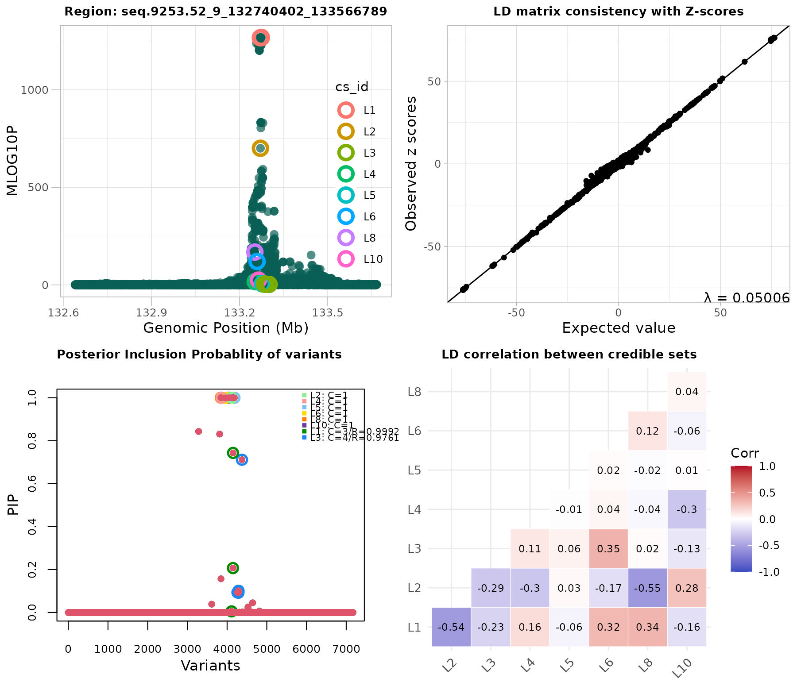
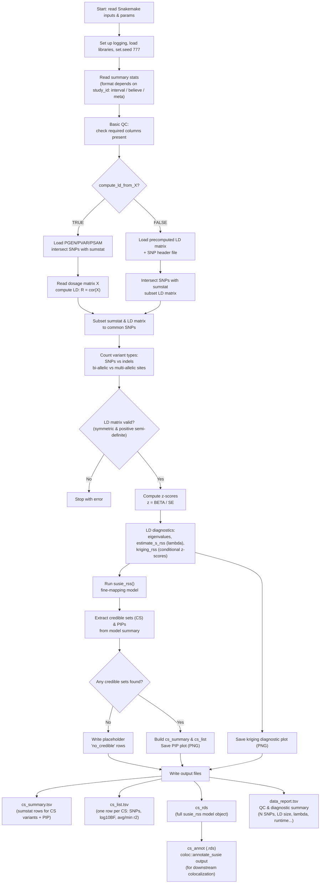
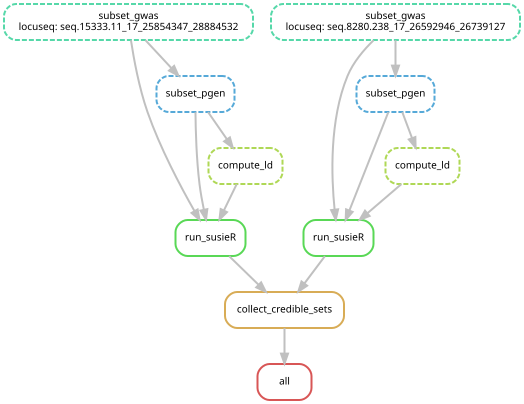

# pqtl_susie
A snakemake pipeline for SuSiE fine-mapping protein QTLs
This workflow deploys a Bayesian fine-mapping approach (link to SuSiE paper) on GWAS summary statistics and in-sample LD.

*Note: This workflow including readme is currently under active development.*

## Inputs
User inputs and configuration params are introduced here.

```YAML
run:
  susie: False
  susier: True
  ld_correlation: False

# paths
workspace_path: "/path/to/your/output/directory"
path_lb: "/path/to/your/loci.csv"
path_gwas: "/path/to/your/harmonized/gwas/"
genotype:  "/path/to/your/harmonized/genotype/split/by/chr"
path_pheno: NULL


sumstat:
  pvalcol: "MLOG10P"
  snpcol: "SNPID"
  chrcol: "CHR"
  study: "YOUR_STUDY_NAME"


# SusieR parameters
susieR:
 min_abs_corr: 0.5
 iter: 1000
 L: 10
 extension: 100000
 estimate_residual_variance: FALSE
```

## Outputs

Output table indicates what to expect from the pipeline.
| No. | File | Content |
|:---:|:------------------|:--------|
|1.   | `data_report.tsv` | Features of genomic regions including QC/diagnostic counts, LD condition number, λ, runtime |
|2.   | `cs_list.tsv`     | One row per 99% credible set (SNPs, log10BF, avg/min r²) |
|3.   | `cs_summary.tsv`  | Per-SNP rows for variants in credible sets, with PIP and full GWAS sumstats |
|4.   | `cs_rds`	      | Full susie_rss model object |
|5.   | `cs_annot`	      | LD-annotated model, ready for coloc |
|6.   | `*_kriging.png`	  | Overview of SuSiE results |


#### 1. Characteristics of the genomic regions

Table: `combined_reports.tsv`
|seqid        |locus                    |nsample_pgen |nvar_pgen | nvar_gwas| nvar_shared| nsnps_shared| nindels_shared| nbi_allelic| nmulti_allelic| run_time_min|ld_from_X | ld_size_mg| lambda | susie_converged | susie_niter | cs_attainable| cs_remained |lambda_warning |susie_warning|
|:------------|:-----------------------|:-----|:-----|-----:|-----:|-----:|-----:|-----:|-----:|-----:|:-----|-----:|-----:|-----:|:-----|:-----|-----:|:-------------|:-----|
|seq.10460.1 |chr1_200795068_203437639 |NA |NA | 1905| 1905| 1773| 132| 1905| 0| 0.11|FALSE | 37.04| 0.0141| TRUE |18|11|5| warning message |NA  |
|seq.10512.13 |chr22_36851809_37058505 |NA |NA | 1348| 1348| 1262|  86| 1348| 0| 0.10|FALSE | 18.42| 0.0028| TRUE |13|6|3| warning message |NA  |
|seq.13268.45 |chr2_20935300_21238858  |NA |NA | 1644| 1644| 1540| 104| 1644| 0| 0.10|FALSE | 27.45| 0.0020| TRUE |5|9|0| warning message |NA  |
|seq.10606.34 |chr2_89119570_96189561  |NA |NA | 1222| 1222| 1161|  61| 1222| 0| 0.11|FALSE | 15.05| 0.0022| TRUE |36|4|2| warning message |NA  |


Description of the reported features:
|Column          | Description                             |
|:---------------|:----------------------------------------|
|seqid           | Phenotype ID                            |
|locus           | Region ID (CHR_START_END)               |
|nsample_pgen    | Number of individuals in genotype file  |
|nvar_pgen       | Number of variants in genotype file     |
|nvar_gwas       | Number of variants in GWAS sumstats     |
|nvar_shared     | Number of variants shared across genotype and GWAS |
|nsnps_shared    | Number of SNPs shared across genotype and GWAS     |
|nindels_shared  | Number of insertion/deletion variants shared across genotype and GWAS |
|nbi_allelic     | Number of bi-allelic variants shared across genotype and GWAS    |
|nmulti_allelic  | Number of multi-allelic variants shared across genotype and GWAS |
|run_time_min    | Run time since loading data to fine-mapping and storing results  |
|ld_from_X       | TRUE/FALSE, TRUE whether LD matrix is computed internally using R-correlation, FALSE if using pre-computed LD |
|ld_size_mg      | Size of pre-computed LD matrix (mega bytes)                  |
|lambda          | Index value for LD-GWAS mismatch, [0,1)                      |
|susie_converged | TRUE/FALSE, TRUE whether susie model converged               |
|susie_niter     | Number of iterations needed for susie model to converge      |
|cs_attainable   | Number of credible sets attainable in the region             |
|cs_remained     | Number of credible sets left after in-built impurity filters |
|lambda_warning  | Any warning message once computing lambda metric             |
|susie_warning   | Any warning message once fitting SuSiE model                 |


#### 2. The 99% credible sets for each fine-mapped genomic region

|seqid        |locus                    | cs_id| cs_log10bf| cs_avg_r2| cs_min_r2| ncs|cs_snps  |
|:------------|:------------------------|---:|--------:|----:|----:|---:|:---------------|
|seq.10460.1  |chr1_200795068_203437639 |   3| 1.15e+01| 1.00| 1.00|   1|1:203211000:C:T |
|seq.10460.1  |chr1_200795068_203437639 |   1| 3.27e+02| 1.00| 1.00|   1|1:203214000:A:C |
|seq.10460.1  |chr1_200795068_203437639 |   2| 1.65e+02| 1.00| 1.00|   1|1:203225000:C:T |
|seq.10460.1  |chr1_200795068_203437639 |   6| 1.01e+01| 0.99| 0.99|   3|1:203229000:GA:G,1:203229000:G:T,1:203230000:C:T |
|seq.10460.1  |chr1_200795068_203437639 |   4| 1.08e+01| 0.95| 0.88|  11|1:203229000:A:G,1:203239000:A:C |
|seq.10512.13 |chr22_36851809_37058505  |   4| 2.93e+01| 0.95| 0.71|  45|22:36908000:A:G,22:36908000:A:T |
|seq.10512.13 |chr22_36851809_37058505  |   1| 6.54e+02| 1.00| 1.00|   1|22:36933000:A:G |
|seq.10512.13 |chr22_36851809_37058505  |   2| 6.42e+01| 1.00| 1.00|   1|22:36937000:G:T |
|seq.13268.45 |chr2_20935300_21238858   | no_credible| NA| NA|   NA|  NA|NA              |
|seq.10606.34 |chr2_89119570_96189561   |   4| 3.25e+04| 0.99| 0.99|   2|2:89125000:A:T,2:89126000:G:T |
|seq.10606.34 |chr2_89119570_96189561   |   2| 1.95e+04| 1.00| 1.00|   1|2:89869000:A:C  |

#### 3. GWAS sumstats of the credible sets
Table: `combined_cssums.tsv`

| seqid       | locus                  | GWAS columns | cs_id | PIP  |
|:------------|:-----------------------|--------------| ----- | ---- |
|seq.10460.1  |chr1_200795068_203437639|    . . .     |   .   |  .   |
|seq.10512.13 |chr22_36851809_37058505 |    . . .     |   .   |  .   |
|seq.10606.34 |chr2_89119570_96189561  |    . . .     |   .   |  .   |


#### 6. Overview of SuSiE results

For a successful run, we expect the pipe to create all the charts below.

<p align="left">
    
<p/>

## SuSiE Best Practice
Flowchart below portrays the logics implemented in `scripts/susie_best_practice.R` broken into stages, from reading the inputs and paramters to generation of fine-mapping results.



## Workflow example



## Acknowledgements
This pipeline is developed by Dariush Ghasemi and Claudia Giambartolomei. Special thanks to:
- Deborah Zani
- Gianmauro Cuccuru
- Giulia Pontali
- Solene Cadiou
- Laura Bondi
- Emanuele Di Angelantonio
